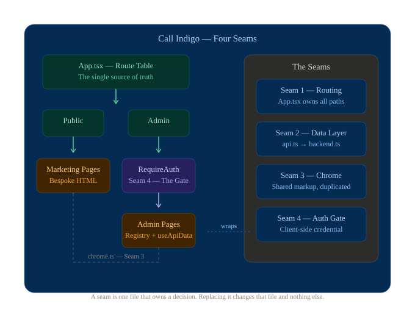

# Architecture — the four seams

**Kind:** living · **Owner:** the repo · **Last verified:** 2026-10-16 in the uncommitted working tree

This is a client-rendered React SPA. It has no server, and that single fact explains
most of its architecture. What follows is not a file listing — it is the four places
where a decision was **isolated so it can be replaced**, plus the reason each one is
shaped the way it is.

> A **seam** is one file that owns a decision. The test of a seam is that replacing
> the decision changes that file and nothing else. Most defects in this codebase are
> a change that reached *past* a seam.

---

## 0. The shape, in one diagram



*Figure 1 — Routing, data layer, chrome, and Clerk identity. Public routes flow to marketing pages; admin routes pass through the Clerk-backed RequireAuth gate.*

```
                          ┌─────────────────────────────┐
   public routes          │  src/App.tsx  (the route      │   admin routes
   ─────────────          │  table)                       │   ────────────
   /            ─────────▶│                               │◀───────── /admin/*
   /residential           └───────────┬───────────────────┘
   /commercial                        │
   /contact                           │ wrapped by
        │                             ▼
        │                   ┌──────────────────┐
        │                   │ RequireAuth      │  ← the gate (seam 4)
        │                   │ Clerk identity   │
        │                   └────────┬─────────┘
        ▼                            ▼
  ┌───────────────────┐    ┌────────────────────────┐
  │ marketing pages   │    │ admin pages            │
  │ (bespoke)         │    │ (registry-only)        │
  │ BODY_HTML strings │    │ useApiData(...)        │
  └─────────┬─────────┘    └───────────┬────────────┘
            │                          │
            ▼                          ▼
  ┌───────────────────┐    ┌────────────────────────┐
  │ chrome.ts         │    │ api.ts   ← the seam    │  seam 2
  │ (seam 3)          │    │ async on purpose       │
  └───────────────────┘    └───────────┬────────────┘
                                       ▼
                           ┌────────────────────────┐
                           │ backend.ts             │  seam 2b
                           │ the ONLY file that     │
                           │ knows it is localStorage│
                           └────────────────────────┘
```

**The import rules that keep the shape:**

| Rule | Enforced by |
|---|---|
| `src/admin/**` may not import from `src/marketing/**`, or the reverse (PRD §7.4.2) | `tests/policy.mjs` — two checks, one per direction |
| A file under `src/components/ui/` that the shadcn CLI did not produce is a PRD §7 violation | `tests/policy.mjs` — "every src/components/ui file is a documented registry component" |
| No page may import `@/lib/data/backend` directly — pages call `api` | **Nothing.** [M: `grep -rn "data/backend" tests/` returns only transpiled copies under the gitignored `tests/.tmp/`] |

> ⚠️ **The third rule is stated in `CONTRIBUTING.md`'s "What we will not merge" and is
> not checked by anything.** It is currently enforced by review and by the fact that
> nobody has broken it. That is the same shape as every other defect this repo has
> paid for — *an assertion that cannot see the thing it claims to check passes
> forever*. Adding the check is tracked in [`../40-project/tasks.md`](../40-project/tasks.md).

---

## Seam 1 — `src/App.tsx`: the route table

The router. One file, one table, and a comment on the one non-obvious decision:

**The guard wraps the layout, not the pages.** `RequireAuth` is applied to
`AdminLayout` rather than living inside it, so an unauthenticated visitor never sees
the sidebar at all. `RequireAuth` renders the sign-in page **in place of** its
children, which is why there is no `/admin/login` route and no redirect loop.

Two catch-alls exist and they behave differently:

| Path | Behaviour |
|---|---|
| An unknown `/admin/*` | **redirects to `/admin/inquiries`** |
| An unknown path anywhere else | redirects to `/` |

> ⚠️ **`src/admin/routes.ts` says the unknown `/admin/*` path "falls through to the
> home page". It does not.** The comment is stale — the code redirects to the inbox.
> The repo wins and the comment is the bug. This is the fourth instance of this
> repo's recurring defect shape, and it is why
> [`../00-meta/`](../00-meta/README.md) exists.

## Seam 2 — the data layer

```
pages  →  api.ts  →  backend.ts  →  localStorage
            ↑
   the only seam; async on purpose
```

| File | Owns | Must never |
|---|---|---|
| `src/lib/data/types.ts` | The domain types, storage-agnostic | know about `localStorage` |
| `src/lib/data/seed.ts` | First-run fixtures — 9 inquiries covering every status, both property types, all three urgency levels | be imported by a page |
| `src/lib/data/backend.ts` | **The only file that knows where data physically lives.** Namespace `call-indigo:v1`. Synchronous and dumb on purpose | be imported by a page |
| `src/lib/data/api.ts` | **The seam.** Every method is `async` even though the local backend is synchronous | — |
| `src/lib/data/hooks.ts` | `useApiData` — the single read path | — |
| `src/lib/data/use-draft.ts` | Draft state that survives a background refresh | — |

### Why `api.ts` is `async` when nothing is asynchronous

The local backend is synchronous. The API is not, on purpose: **a real HTTP backend
will not be**, so the call sites are already written for the world where this returns
a network promise. Replacing `localStorage` with `fetch` is a change to `api.ts` alone
(PRD §16.2 **F2**).

There is a 140 ms simulated latency for the same reason — a UI that only ever renders
its loaded state is a UI whose loading state is untested.

### Why a version counter, and not React state

Mutations call `bump()`, which increments a counter and notifies subscribers.
`useApiData` subscribes via `useSyncExternalStore`.

That is what makes **submitting the form on `/contact` repaint the dashboard inbox
without either page knowing the other exists.** No context, no prop drilling, no
global store — one integer and a `Set` of listeners.

`useApiData(key, load)` takes an explicit `key` rather than a dependency array. That
is deliberate: a dependency array built from inline values defeats the lint rule that
would catch a missing dependency.

### The three honest limitations

1. **`localStorage` is not a database.** Data is per-browser, is not shared between
   users or devices, and is cleared with site data.
2. **Corrupt JSON and a full quota both fall back rather than taking the page down.**
   That is a resilience choice, and it means a write can fail silently by design.
3. **Reset demo data** clears the whole namespace and restores the seed fixtures. It
   does **not** sign the operator out — Clerk manages the auth session separately from
   the app's `call-indigo:v1:` localStorage namespace (see seam 4).

Full detail: [`../60-reference/data-layer.md`](../60-reference/data-layer.md).

## Seam 3 — the marketing chrome

**This is the seam that surprises people.** The three marketing pages render their
markup from a `BODY_HTML` string literal via `dangerouslySetInnerHTML`. The top bar,
header, mobile drawer, footer and legal modals are **duplicated inside all three
literals.**

| File | Owns |
|---|---|
| `src/marketing/chrome-markup.ts` | The raw markup, **extracted from the prototype** |
| `src/marketing/chrome.ts` | The composed markup, with SPA `href` rewrites applied. Exports `TOPBAR_HTML`, `FOOTER_HTML`, `LEGAL_MODALS_HTML`, `NAV_ITEMS`, `headerNav()`, `drawerNav()`, `headerHtml()`, `drawerHtml()` |
| `src/marketing/SiteChrome.tsx` | Composes top bar + header + drawer + footer + legal modals |
| `src/marketing/useSiteChrome.ts` | The port of the prototype's `js/main.js` behaviour |

> ⚠️ **`chrome-markup.ts` is GENERATED** by `scripts/_brand.py` and `scripts/_legal.py`.
> **A needle in those scripts that stops matching fails silently** — the script
> reports success and writes the un-substituted markup. If you change a brand string
> or a legal string, verify the *generated* file, not the script's exit code.

**The practical consequence:** a change to `chrome.ts` reaches **one page of four**.
Four pages render the chrome — home, residential, commercial, and contact — and the
first three carry their own copy. A fix applied to home alone is a fix to a quarter of
the site, and it will look correct in a browser if you only open home.

## Seam 4 — Clerk identity for the admin UI

`src/admin/AdminArea.tsx` mounts `ClerkProvider` when the Vercel-supplied publishable key is present;
the admin entry point is lazy-loaded so marketing visitors do not download Clerk.
`src/admin/RequireAuth.tsx` waits for Clerk to load, requires a signed-in user, and then
requires `publicMetadata.role === "admin"` before rendering `AdminLayout`. The role check
fails closed. The sign-in page and account menu use Clerk's prebuilt React components.

The React guard controls the visible SPA only. It is not server authorization: all app
code is public, and dashboard records remain in browser `localStorage`. The Clerk secret
key is not used by Vite and must remain server-only. The Vercel-to-Vite public-key mapping
is documented in [`../30-operations/environments.md`](../30-operations/environments.md).
See [ADR 0005](../40-project/decisions/0005-clerk-admin-identity.md) for the decision and
its limits.

---

## What is *not* here, and why

| Absent | Reason |
|---|---|
| A state library (Redux, Zustand) | One integer and a listener `Set` covers it. See seam 2. |
| SSR or pre-rendering | Client-rendered SPA. The SEO consequence is noted in PRD §15 R4. |
| A backend | `localStorage` behind the `api.ts` seam. F2 is the replacement. |
| A CMS | Copy is inline in the marketing pages. Editing Settings does **not** rewrite them, and the Settings page says so on screen. F4. |
| A `tailwind.config.js` | Tailwind v4 is configured in CSS. See [`css-pipeline.md`](./css-pipeline.md). |
